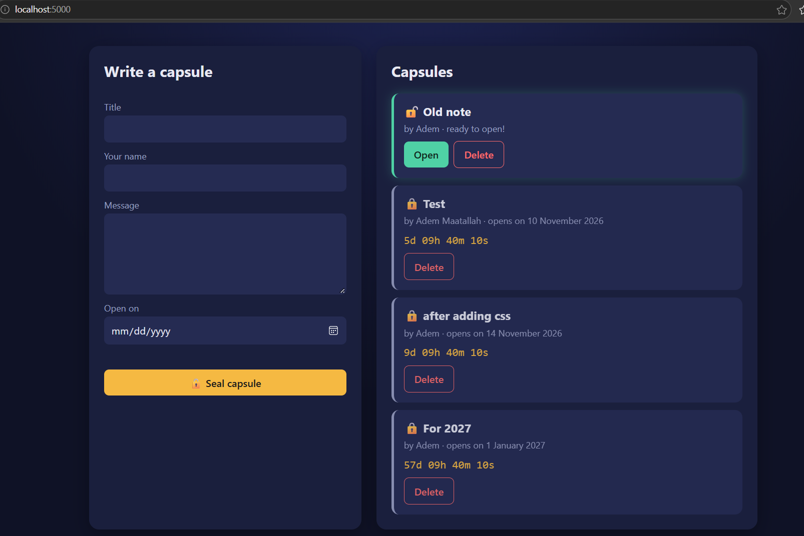

# ⏳ Digital Time Capsule

A one-page web app where you write messages to the future. Each capsule has
an open date, and the Flask API keeps its message locked until that date
arrives. Until then, you only see the title and a live countdown.



🌐 **Live demo:** https://USERNAME.pythonanywhere.com
## Features

- Write a capsule with a title, message, author and open date
- See all capsules, marked 🔒 locked or 🔓 unlocked
- Live countdown (days, hours, minutes, seconds) for locked capsules
- Open unlocked capsules and read them like a letter
- Delete capsules
- Responsive layout for desktop and mobile

## The key rule

The lock is enforced by the **server**, not the browser. While a capsule is
locked, the API never sends its message, even if someone calls the API
directly or changes their computer's clock. The countdown on the page is
only for display; the backend is the authority.

## Tech stack

- **Backend:** Python, Flask
- **Database:** SQLite (built into Python)
- **Frontend:** HTML, CSS and JavaScript (Fetch API), no frameworks

## How to run it

1. Clone the repository:
   ```bash
   git clone https://github.com/adem-maatallah/time-capsule.git
   cd time-capsule
   ```
2. Create and activate a virtual environment:
   ```bash
   python -m venv .env-capsule
   .env-capsule\Scripts\activate        # Windows
   source .env-capsule/bin/activate     # Mac/Linux
   ```
3. Install the dependencies:
   ```bash
   pip install -r requirements.txt
   ```
4. Start the server:
   ```bash
   python app.py
   ```
5. Open http://127.0.0.1:5000 in your browser.

The database file (`capsules.db`) is created automatically on first start.

## API

All endpoints return JSON.

| Method | Endpoint             | Description                         | Status codes       |
|--------|----------------------|-------------------------------------|--------------------|
| GET    | `/api/capsules`      | List all capsules (without messages)| 200                |
| POST   | `/api/capsules`      | Create a capsule                    | 201, 400           |
| GET    | `/api/capsules/<id>` | Open a capsule                      | 200, 404, 423      |
| DELETE | `/api/capsules/<id>` | Delete a capsule                    | 200, 404           |

**Create a capsule (request body):**
```json
{
  "title": "For 2027",
  "message": "Hello future me!",
  "author": "Adem",
  "open_date": "2027-01-01"
}
```

**Opening a locked capsule** returns `423 Locked` with the title, author,
open date and days left, but no message.

**Validation:** all fields are required, and `open_date` must be a valid
date (`YYYY-MM-DD`) in the future. Otherwise the API returns `400` with an
error message, which the page displays under the form.

## Project structure

```
time-capsule/
├── app.py            # Flask app, API routes and the lock rule
├── database.py       # SQLite setup and helper functions
├── templates/
│   └── index.html    # the single page
├── static/
│   ├── style.css     # styling
│   └── script.js     # fetch calls, rendering, countdown
├── docs/
│   └── screenshot.png
├── requirements.txt
└── README.md
```

## Security notes

- **SQL injection:** all queries use parameter placeholders (`?`) instead
  of inserting user input into SQL strings.
- **XSS:** user content is inserted into the page with `textContent`, never
  `innerHTML`, so any HTML or scripts are shown as plain text.
- **Server-side validation:** the browser checks input for convenience, but
  the API validates everything again, since it can be called directly.
## Known limitations

- There is no user authentication, so anyone with the link can create
  or delete capsules.
- The server uses UTC, so capsules unlock at midnight UTC.
- Hosted on a free PythonAnywhere account, which must be renewed
  regularly to stay online.

## Development

Built for the Information System Development course (WS26) at the
University of Liechtenstein. The code was written step by step with the
help of an LLM chat assistant for explanations.